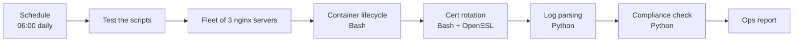

# Bash and Python operations automation

The repetitive ops jobs that let configuration drift in, automated and run **every morning on a schedule**:
heal stuck containers, rotate expiring TLS certificates, parse the logs, and put any drifted server back on the security baseline.

[Live pipeline →](https://danielkojomegbenu.com/projects/ops-automation)

## The pipeline



Each run starts a fleet of three nginx servers with problems planted on purpose, the kind that pile up on real servers:

| Server | Planted problem | Found and fixed by |
|---|---|---|
| web1 | none, the control | |
| web2 | its app gets stuck, so the health check fails | **Container lifecycle**: restarts unhealthy containers and waits until they're healthy |
| web3 | its TLS certificate expires in 3 days | **Certificate rotation**: issues a new 90-day certificate from the fleet CA and reloads nginx with no downtime |
| web3 | someone hand-edited its config: old TLS versions, a version banner, no HSTS | **Compliance check**: re-applies the approved baseline and checks again |

| Step | What it does | Fails the run when |
|---|---|---|
| Test the automation | `shellcheck` on every Bash script, and unit tests for the Python | A test or lint fails |
| Container lifecycle | Restarts any container whose health check is failing, then prunes stopped containers and dangling images | A container won't come back healthy |
| Certificate rotation | Reads the certificate each server is **actually serving**, and renews anything expiring within 30 days | The new certificate isn't live after the reload |
| Log parsing | Summarises the JSON access logs per server: requests, 4xx, 5xx, top errors | No log lines can be parsed |
| Compliance check | Checks TLS 1.2+ only, no version banner, HSTS, and certificates valid for 30+ days. Fixes drift, then re-checks | Anything is still non-compliant after the fix |
| Ops report | One table of what was found and fixed, in the job summary and as an artifact | |

## The compliance baseline

`fleet/baseline.conf.template` is the one approved config. The policy in `scripts/compliance.py` checks live servers against it:

| Check | Why |
|---|---|
| Only TLS 1.2 and 1.3 | TLS 1.0 and 1.1 are deprecated and fail audits |
| No version in the `Server` header | Don't advertise which version to attack |
| HSTS header | Browsers stay on HTTPS |
| Certificate valid for 30+ days | Plenty of warning before anything expires |

## See weakened standards fail the run

Open the pull request **demo/weak-baseline**. It adds TLS 1.1 back into the approved baseline itself.
The compliance check re-applies the baseline to every server, finds they're all still non-compliant, and fails the run. The policy protects the baseline, not just the servers.

## Run it on your machine

```bash
bash scripts/seed_fleet.sh
bash scripts/container_lifecycle.sh
bash scripts/rotate_certs.sh
python3 scripts/parse_logs.py
python3 scripts/compliance.py
python3 scripts/report.py
docker compose down
```

## What's in the repo

| Path | What it is |
|---|---|
| `fleet/baseline.conf.template` | The approved nginx config |
| `docker-compose.yml` | The three-server fleet |
| `scripts/seed_fleet.sh` | Builds the fleet and plants the problems |
| `scripts/container_lifecycle.sh`, `scripts/rotate_certs.sh` | The Bash automation |
| `scripts/parse_logs.py`, `scripts/compliance.py`, `scripts/report.py` | The Python automation |
| `tests/` | Unit tests for the parsing and the compliance policy |
| `.github/workflows/ops-daily.yml` | The schedule and the pipeline |

## Cost

Free. Everything runs on the GitHub runner, and GitHub Actions is free for public repos.
